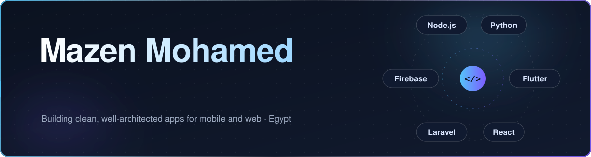
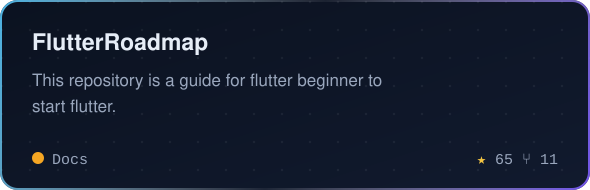
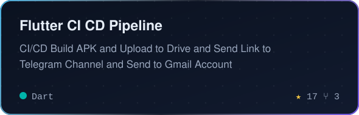
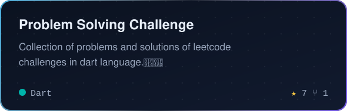
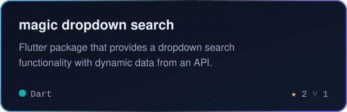
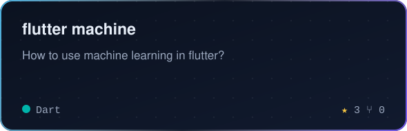
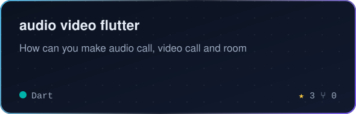

  

  &nbsp;&nbsp;
  &nbsp;&nbsp;
  &nbsp;&nbsp;
  

  

## About me

I'm a software engineer who ships products end to end: mobile apps, web dashboards, backends and the CI/CD around them. Most of my work is in Flutter, and I publish open-source packages and guides for the community.

- 📱 Mobile apps with Flutter and Dart, including maps, BLE, payments, audio/video calls and on-device ML
- 🌐 Web dashboards and sites with React, TypeScript and Firebase
- ⚙️ Backends and APIs with Laravel, Node.js and Python
- 📦 Author of Flutter packages and of a Flutter roadmap starred by the community
- 🎓 BSc. in Computer Science, Pre-Masters at Mansoura University

  

## Featured open source

  
  

  
  

  
  

  

  

  <picture>
    <source media="(prefers-color-scheme: dark)" srcset="https://raw.githubusercontent.com/MZzzNn/MZzzNn/github-contribution-snake-output/github-contribution-grid-snake-dark.svg" />
    
  </picture>

