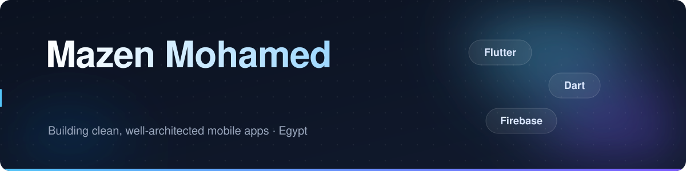

<p align="center">
  
</p>

<p align="center">
  <a href="https://www.linkedin.com/in/MZzzNn"></a>&nbsp;&nbsp;
  <a href="mailto:mazenn770@gmail.com"></a>&nbsp;&nbsp;
  <a href="https://twitter.com/MZzzNn_"></a>&nbsp;&nbsp;
  <a href="https://www.facebook.com/MaZenn.mo7amed"></a>
</p>

<p align="center">
  <a href="https://wakatime.com/@MZzzNn"></a>
  
</p>

## About me

I'm a software engineer focused on mobile. I build Flutter apps with clean code and solid architecture, and I contribute to open-source projects.

- 📱 **Flutter Developer** building cross-platform apps with Dart
- 🎓 Pre-Masters at Mansoura University, BSc. in Computer Science
- 🌱 Currently learning native Android and iOS development
- 💬 Ask me about app development and web development
- 🎯 Interests: mobile programming, ML, AI, path planning

## Tech stack

<p align="center">
  <a href="https://skillicons.dev"></a>
  <br/>
  <a href="https://skillicons.dev"></a>
</p>

## Coding activity

All-time coding time by language, updated automatically from [WakaTime](https://wakatime.com/@MZzzNn).

<!--START_SECTION:waka-->

```txt
Total Time: 6,335 hrs 15 mins

Dart                          4,805 hrs 53 mins⣿⣿⣿⣿⣿⣿⣿⣿⣿⣿⣿⣿⣿⣿⣿⣿⣿⣿⣷⣀⣀⣀⣀⣀⣀   75.86 %
Other                         783 hrs 42 mins ⣿⣿⣿⣀⣀⣀⣀⣀⣀⣀⣀⣀⣀⣀⣀⣀⣀⣀⣀⣀⣀⣀⣀⣀⣀   12.37 %
Markdown                      241 hrs 5 mins  ⣷⣀⣀⣀⣀⣀⣀⣀⣀⣀⣀⣀⣀⣀⣀⣀⣀⣀⣀⣀⣀⣀⣀⣀⣀   03.81 %
YAML                          180 hrs 20 mins ⣶⣀⣀⣀⣀⣀⣀⣀⣀⣀⣀⣀⣀⣀⣀⣀⣀⣀⣀⣀⣀⣀⣀⣀⣀   02.85 %
JSON                          53 hrs 19 mins  ⣄⣀⣀⣀⣀⣀⣀⣀⣀⣀⣀⣀⣀⣀⣀⣀⣀⣀⣀⣀⣀⣀⣀⣀⣀   00.84 %
XML                           46 hrs 39 mins  ⣄⣀⣀⣀⣀⣀⣀⣀⣀⣀⣀⣀⣀⣀⣀⣀⣀⣀⣀⣀⣀⣀⣀⣀⣀   00.74 %
Bash                          34 hrs 19 mins  ⣀⣀⣀⣀⣀⣀⣀⣀⣀⣀⣀⣀⣀⣀⣀⣀⣀⣀⣀⣀⣀⣀⣀⣀⣀   00.54 %
Text                          26 hrs 24 mins  ⣀⣀⣀⣀⣀⣀⣀⣀⣀⣀⣀⣀⣀⣀⣀⣀⣀⣀⣀⣀⣀⣀⣀⣀⣀   00.42 %
Python                        19 hrs 22 mins  ⣀⣀⣀⣀⣀⣀⣀⣀⣀⣀⣀⣀⣀⣀⣀⣀⣀⣀⣀⣀⣀⣀⣀⣀⣀   00.31 %
Groovy                        18 hrs 2 mins   ⣀⣀⣀⣀⣀⣀⣀⣀⣀⣀⣀⣀⣀⣀⣀⣀⣀⣀⣀⣀⣀⣀⣀⣀⣀   00.28 %
```

<!--END_SECTION:waka-->

## GitHub stats

<p align="center">
  
</p>
<p align="center">
  
  
</p>

## Contributions

<p align="center">
  <picture>
    <source media="(prefers-color-scheme: dark)" srcset="https://raw.githubusercontent.com/MZzzNn/MZzzNn/github-contribution-snake-output/github-contribution-grid-snake-dark.svg" />
    
  </picture>
</p>


